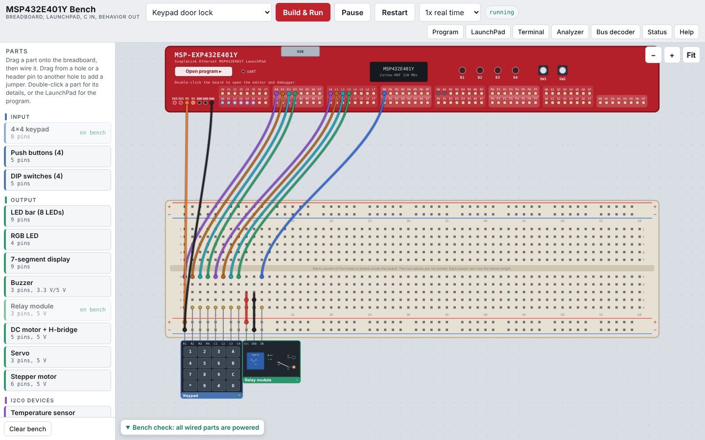
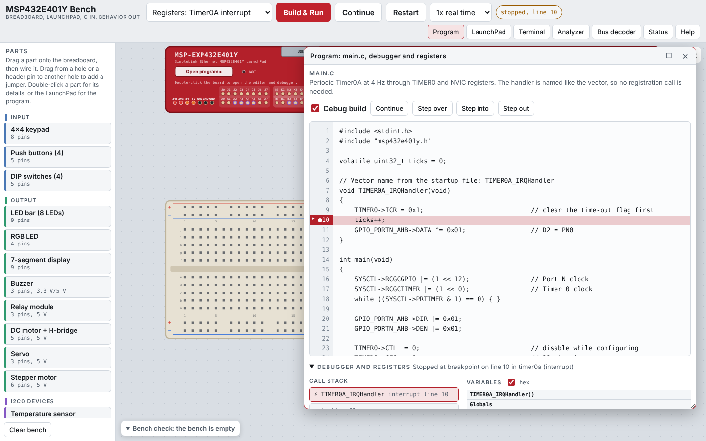

# MSP432E401Y Simulator

A browser-based simulator for the MSP-EXP432E401Y LaunchPad. You build a circuit on a breadboard, write C with the usual TivaWare/DriverLib calls or direct register access, press **Build & Run**, and watch the board and the parts you wired react. There is nothing to install and no toolchain: the C is translated to JavaScript and run on a virtual clock.

It was built for teaching embedded systems (intro engineering, embedded-systems lab, senior design). The simulator checks for the mistakes students actually make and explains them in plain English, for example using a peripheral before enabling its clock, forgetting to clear an interrupt, or addressing an I2C device that is not there.



## Contents

- [Quick start](#quick-start)
- [What is simulated](#what-is-simulated)
- [The bench](#the-bench)
- [I2C and SPI](#i2c-and-spi)
- [Debugger](#debugger)
- [Register-level programming](#register-level-programming)
- [Examples](#examples)
- [How it works](#how-it-works)
- [Repository layout](#repository-layout)
- [Building and testing](#building-and-testing)
- [Limitations](#limitations)

## Quick start

Open `index.html` in a current desktop or mobile browser. It is one self-contained page: the [acorn](https://github.com/acornjs/acorn) parser (MIT licensed) is inlined, so it works offline. The only optional external file is the Google font, and the page falls back to system fonts without it.

1. Pick an example from the drop-down. It puts the parts it needs on the breadboard and wires them. Or start from an empty bench: drag parts from the left pane onto the breadboard and wire them yourself.
2. Double-click the LaunchPad to open the **Program** window (editor, debugger and register viewer), or write your own code there.
3. Press **Build & Run**. Compile errors show the C line number.
4. Press the keys, switches and buttons on the parts. Read the UART output in **Terminal**. Open **Analyzer** for pin waveforms and **Bus decoder** for I2C and SPI transactions.

Your code, bench and settings are saved in the browser's local storage. A saved wiring from the earlier, tick-box version of the simulator is carried over onto the bench.

To host it with GitHub Pages, commit `index.html` to the repository root, then go to Settings, Pages, choose "Deploy from a branch", pick the branch and the `/ (root)` folder. The site appears at `https://<user>.github.io/<repo>/` after a minute or two. Any static host works the same way.

## What is simulated

| Area | Details |
|---|---|
| Board | MSP432E401Y on the LaunchPad: user LEDs D1-D4 (PN1, PN0, PF4, PF0), switches SW1/SW2 (PJ0/PJ1, with the weak pull-ups that must be enabled), analog inputs, die temperature sensor |
| Clock | 16 MHz default, plus the main oscillator, PLL and `SysCtlClockFreqSet` up to 120 MHz. Selecting the PLL before it is powered, or computing a clock above 120 MHz, is flagged |
| GPIO | All ports, direction, pull-ups, open-drain, alternate functions through `AFSEL`/`PCTL`, per-pin and per-port interrupts |
| Timers | Timer0-7, periodic and one-shot, 32-bit or split A/B with prescaler, interrupts |
| SysTick | Reload, current value, COUNTFLAG, interrupt |
| NVIC | Enable, pending, priorities, real MSP432E4 IRQ numbers. A handler is found by its vector-table name (`Timer0A_Handler`, `GPIOJ_Handler`, `I2C0_Handler`, ...) or registered with `IntRegister` |
| UART0 | Baud rate, FIFOs, interrupts, a terminal with keyboard input, `UARTprintf` and `printf` |
| ADC0/1 | Processor-triggered sequencers, 12-bit conversions with conversion time, interrupts |
| PWM0 | Generators, compare and load values, action sequences, output pins |
| I2C0 | Master mode, 100 kHz and 400 kHz, DriverLib and registers, interrupt |
| SSI0 | SPI master, modes 0-3, 4-16 bit frames, FIFOs, interrupt, loopback, hardware or GPIO chip select |
| Faults | Writing to a peripheral with its clock off is a bus fault, as is accessing an address that is not a peripheral or RAM. A missing interrupt clear is detected as an interrupt storm. Both are reported with an explanation |

Delays, timer periods, UART baud rate, ADC conversions and bus transfers take the time they would on the board. Ordinary C statements cost nothing, so tight loops are only approximately timed. The speed selector runs the virtual clock slower or faster than real time.

## The bench

The main screen is a large breadboard with the LaunchPad above it. The left pane lists every part.

- **Place a part.** Drag it onto the breadboard, or click it in the list and then click a spot on the board. Parts that fit the upper half plug in above the board, the others below.
- **Wire it.** Drag from any breadboard hole, or from a header pin on the LaunchPad, to another hole to add a jumper. Or click one end and then the other. Drag a wire end to move it, select a wire and press Delete to remove it.
- **Rows are real.** The five holes of a column are joined, the two halves of the board are not, and each power rail runs the whole length. A jumper to the wrong column does nothing.
- **Power is required.** Every part needs VCC and GND wired. A part that is not powered does nothing, and the bench check box lists what is missing. Parts that need 5 V (relay, motors, servo, LCD) do not work from 3.3 V. Joining 3.3 V, 5 V and ground together is a short circuit and stops the run.
- **Common pins.** For parts with a COM pin (LED bar, RGB LED, 7-segment, buttons, DIP switches) the COM wire decides common anode/cathode or pull-up/pull-down. Connect it to GND or VCC.
- **Open the parts.** Double-click a part for its settings and a wiring table that shows which pin each wire reaches. Double-click the LaunchPad for the program editor and debugger.
- **Windows.** Program, LaunchPad (analog sliders, on-board jumpers, pin list), Terminal, Analyzer, Bus decoder, Status and Help are floating windows. Drag by the title, resize from the corner, double-click the title to maximize.
- **On a phone** the windows fill the screen and the parts list is a drawer. Pinch to zoom the bench.

Parts read the real pin signals, so GPIO, PWM and timer-driven outputs all work. Conflicts are flagged: two parts on one pin, a part on a pin the LaunchPad already uses, I2C or SPI devices on the wrong pins, or two outputs sharing one PWM generator and therefore one period. Only one of each part can be on the bench.

| Part | Notes |
|---|---|
| 4x4 keypad | Rows and columns on any pins. No pull-ups of its own, with optional contact bounce |
| Relay module | Active-high or active-low input, with status LEDs |
| LED bar, RGB LED | Active-high or common-anode wiring. The RGB LED responds to PWM |
| 7-segment display | Common anode/cathode |
| Buzzer | Passive (pitch follows the signal frequency, with audio) or active |
| DC motor with H-bridge | Direction, braking, speed from PWM duty |
| Servo | Pulse range selectable, angle follows the pulse width |
| Stepper motor | 28BYJ-48 half-stepping, shows the rotor position |
| DIP switches, push buttons | Pull-up or pull-down wiring, bounce option |

## I2C and SPI

I2C0 uses PB2 (SCL) and PB3 (SDA). SSI0 uses PA2 (CLK), PA3 (FSS), PA4 (MOSI) and PA5 (MISO). The simulator generates the bus waveforms bit by bit at the programmed clock rate, so you can see them in the logic analyzer, and it decodes every transaction in the **Bus decoder** panel (start, repeated start, stop, ACK/NACK, chip-select frames with MOSI and MISO bytes).

Virtual devices you can place on the bench (wire their SCL/SDA or CLK/MOSI/MISO/CS pins to the matching LaunchPad pins):

| Device | Bus | What it models |
|---|---|---|
| TMP102 temperature sensor | I2C | Temperature slider, 12-bit register, pointer register, selectable address 0x48-0x4B |
| 24C02 EEPROM (256 B) | I2C | 8-byte pages, 5 ms write cycle during which it does not acknowledge (acknowledge polling works) |
| HD44780 16x2 LCD behind a PCF8574 | I2C | 4-bit initialisation sequence, busy times (commands sent too fast are lost and reported), cursor, custom characters |
| SSD1306 OLED 128x64 | I2C | Command and data streams, addressing modes, charge pump. The panel stays dark until it is switched on correctly |
| 25LC256 EEPROM (32 KB) | SPI | WREN, WRITE, READ, RDSR, 64-byte pages, write-in-progress timing |
| 74HC595 with 8 LEDs | SPI | Shift register with latch on chip-select release |

I2C addresses and SPI chip-select pins are selectable, and address collisions are reported. EEPROM contents survive a restart of your program, as they would on a real board.

Messages the bus code produces include: SDA/SCL pins not set up for I2C, SDA not open-drain, no pull-ups, no device at an address, a command written while the controller was busy, an SPI write without WREN, a chip select raised before the last byte had left, and a hardware frame-select that drops between bytes in SPI mode 0.

## Debugger

Open the Program window, tick **Debug build**, then click a line number or press F9 to set a breakpoint.

- Step over, step into, step out (F10, F11, Shift+F11), continue, pause
- Conditional breakpoints
- Call stack, with interrupt handlers marked as having interrupted `main`
- Local and global variables, and watch expressions such as `count * 2` or `GPIO_PORTN_AHB->DATA`
- Live peripheral register viewer for GPIO, SYSCTL, timers, UART, ADC, PWM, I2C0, SSI0, SysTick and NVIC. Click a value to write the register while stopped

Debug builds run somewhat slower.



## Register-level programming

Besides DriverLib, these all work:

```c
SYSCTL->RCGCGPIO |= (1u << 12);                 // CMSIS-style structs
GPIO_PORTN_AHB->DATA ^= 0x01;
TIMER0_CTL_R = 0;                               // TivaWare register names
HWREG(GPIO_PORTN_BASE + GPIO_O_DIR) |= 1;       // HWREG
*(volatile uint32_t *)0x400643FC = 1;           // raw addresses
NVIC_EnableIRQ(TIMER0A_IRQn);                   // CMSIS NVIC and SysTick functions
```

Registers have the real offsets, reset values, write-one-to-clear behaviour and side effects, and each access costs cycles. Writing a peripheral register while its clock is off is a bus fault, and so is touching an address that is neither a peripheral nor RAM. Unimplemented peripheral pages read as zero and report that writes are ignored.

## Examples

30 programs, in the drop-down. Choosing one puts the parts it needs on the bench, wired the way its code expects, and removes the parts of the previous example. Parts and wires you added yourself stay.

| Group | Examples |
|---|---|
| Basics | blink, buttons, button interrupt, timer interrupt, UART + LEDs, ADC, PWM fade |
| Parts | keypad, relay, door lock, LED bar, DIP switches, RGB, 7-segment counter, buzzer melody, motor control, servo sweep, stepper |
| Registers | register blink, timer interrupt, UART echo, button interrupt |
| I2C | bus scanner, temperature sensor, EEPROM write and read with acknowledge polling, LCD, OLED |
| SPI | 25LC256 EEPROM, 74HC595 chaser |
| Both, register level | I2C0 temperature read shown on 595 LEDs through SSI0 |

## How it works

1. **Compiler.** A C subset (preprocessor with `#define`, declarations, casts, arrays, string literals, functions, interrupt handlers) is tokenised and rewritten to JavaScript generator functions. Register and `HWREG` accesses are rewritten to the memory-mapped register layer. Pass two uses acorn to edit the syntax tree: blocking calls become `yield*`, integer arithmetic gets C semantics, and loops get a time budget so a program cannot hang the page.
2. **Virtual clock.** Time advances only when your program calls something that takes time or when the loop budget is spent. A scheduler holds timed events (timer expiry, UART bytes, ADC conversions, bus edges, part motion) and runs them when the virtual clock reaches them.
3. **Interrupts.** Handlers run as generators pumped between statements, in priority order. A debugger stop inside a handler pauses the whole machine.
4. **Pins.** Every pin level is computed from direction, `AFSEL`/`PCTL` alternate function, pull-ups and whatever a part drives onto it. Parts and the logic analyzer read the same signals.
5. **Debug builds.** The compiler inserts a hook before each statement and wraps functions in enter/leave frames. The hook stops execution at breakpoints and gives the debugger access to local scope.

## Repository layout

```
head.html, body.html     page shell, styles, help text
core.js                  simulator core: clock, scheduler, GPIO, timers, UART, ADC, PWM, NVIC, debugger engine
regs.js                  memory-mapped register layer and register name tables
buses.js                 I2C0, SSI0, bus waveforms, protocol log, virtual I2C and SPI devices
api.js                   DriverLib/CMSIS functions and constants
parts.js, parts2.js      add-on parts model (keypad, relay, motors, ...)
bench.js                 breadboard model: holes, rails, jumpers, part definitions, power and short-circuit checks
compiler.js              C subset to JavaScript
examples.js              the 30 example programs
ui_win.js                floating windows
ui_parts.js              part settings cards, validation, bus decoder panel
ui_bench.js              breadboard drawing, drag and drop, wiring, part faces
ui_dbg.js                debugger panels and register viewer
ui.js                    editor, terminal, logic analyzer, status, window setup
build.sh                 concatenates the files above into app.html
index.html               built, self-contained page for GitHub Pages or any static host
app.html                 same program as an HTML fragment (no doctype), used for publishing inside Claude artifacts; not needed on GitHub
test.js                  headless test harness
tests*.js, e2e_bench*.js, smoke_bench.js   test suites
```

## Building and testing

Requires Node.js 18 or newer.

```sh
npm install        # acorn and jsdom (Playwright is optional, for the browser tests)
bash build.sh      # writes index.html (acorn inlined) and app.html
```

Run all headless suites with `npm test`. Individually:

```sh
node tests.js          # examples and core behaviour
node tests2.js         # parts model
node tests_bench.js    # breadboard rows, rails, power, shorts, auto-wiring of all examples
node tests_regs.js     # register layer, clocks, interrupts
node tests_dbg.js      # breakpoints, stepping, watch
node tests_bus.js      # I2C, SPI, devices, bus examples
node smoke_bench.js    # UI smoke test in jsdom (run build.sh first; uses app.html)
node e2e_bench.js      # drag and drop, wiring, windows in real Chromium (needs Playwright)
node e2e_bench2.js     # click placement, moving parts and wires, key presses, reload, migration
```

Each prints `ALL ... PASSED` on success. `shot_readme.js` regenerates the README screenshots with Playwright and is not part of the test suite.

## Limitations

- **Not an instruction-set simulator.** It runs your C as translated JavaScript, not ARM machine code. Inline assembly, startup files, linker scripts, and binaries built by Code Composer Studio or Keil cannot be loaded. Timing is accurate where hardware sets it (delays, timers, bus transfers) and approximate for plain code.
- **C subset.** No pointer arithmetic (`*s++` is a compile error that says so), structs or function pointers. Arrays, indexing, pointers to variables and arrays, and passing arrays to functions work. `UARTprintf` has no `%f`, like the real library; `printf` does.
- **Peripherals not simulated:** UART1-7 (stubs), I2C1-3, SSI1-3, I2C and SPI slave modes, I2C clock stretching and arbitration, DMA, Ethernet, USB, CAN, EEPROM peripheral, hibernation, watchdogs, comparators, QEI.
- **ADC** supports processor triggers only. **Timers** do not model capture or RTC modes.
- **Interrupts** are prioritised but handlers are not preempted or nested.
- APB GPIO aliases map to the AHB registers.
- **Bench:** one of each part type, and no potentiometer part yet (analog inputs are sliders in the LaunchPad window). Wires are ideal: no resistance, current or LED burn-out is modeled, only connectivity, supply voltage and shorts.
